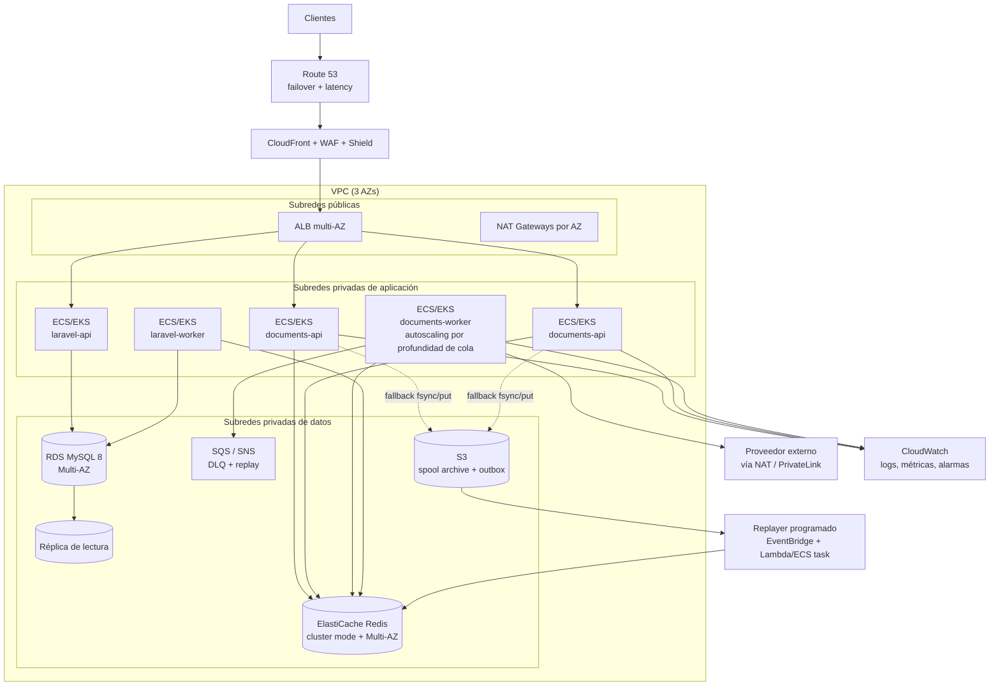

# Prueba Técnica Backend Senior — Estupendo

**Hugo Fabián Horta Flórez**

Módulo Laravel para procesar **100.000 facturas** con un pico de memoria PHP **< 32 MB** y microservicio **FastAPI** asíncrono con reintentos, circuit breaker, DLQ y spool durable en disco. Todo el stack se levanta con `docker-compose` (Laravel, FastAPI, MySQL y Redis) e incluye el análisis de una arquitectura AWS de alta disponibilidad.

> **Estado:** implementación completa y validada con ejecuciones reales (PHP 8.3.32 + MariaDB 10.6 + Python 3.10). Los números de rendimiento y memoria de este README son medidos, no estimados.

## Índice

1. [Resumen de decisiones](#resumen-de-decisiones)
2. [Estructura del repositorio](#estructura-del-repositorio)
3. [Inicio rápido](#inicio-rápido)
4. [Parte 1 — Laravel: 100k facturas bajo 32 MB](#parte-1--laravel-100k-facturas-bajo-32-mb)
5. [Parte 2 — FastAPI: asincronía y resiliencia](#parte-2--fastapi-asincronía-y-resiliencia)
6. [Parte 3 — Docker y arquitectura AWS](#parte-3--docker-y-arquitectura-aws)
7. [Cuestionario de defensa técnica](#cuestionario-de-defensa-técnica)
8. [Evidencia de ejecución](#evidencia-de-ejecución)
9. [Trade-offs y siguientes pasos](#trade-offs-y-siguientes-pasos)
10. [Checklist de requisitos](#checklist-de-requisitos)

---

## Resumen de decisiones

| Requisito | Decisión | Por qué |
|---|---|---|
| 100k facturas, pico < 32 MB | **Keyset pagination** (`id > lastId`) + PDO **unbuffered** + filas como arrays, sin hidratar Eloquent | El coste de memoria pasa a ser O(batch), no O(total). `chunk()`/`chunkById()` hidratan modelos y siguen gastando memoria y consultas por fila. |
| Evitar OFFSET | Índice compuesto `(status, id)` y cursor por `id` | `OFFSET` obliga a MySQL a leer y descartar todas las filas anteriores: coste lineal por página. El keyset es un range scan de coste constante. |
| Actualizar 100k filas | **Un `UPDATE ... CASE id WHEN ...` por lote** (~500 filas) | 200 round-trips en vez de 100k, sin 100k locks fila a fila ni 100k sentencias en el undo log. |
| Evento por factura | Evento de dominio por lote (`InvoiceBatchProcessed`) **por defecto**; `--events=per_invoice` disponible | Un evento por fila multiplica el coste; el modo literal queda implementado y medido. |
| `DB::transaction` única | Modo `chunked` (transacción corta por lote) por defecto; `--transaction=single` implementado | Una transacción de 100k filas mantiene locks, undo log y snapshot durante toda la corrida. Análisis y evidencia en la [respuesta 4](#4-criterio-de-arquitectura-análisis-crítico). |
| 202 en < 200 ms | Validación pydantic + **un pipeline MULTI/EXEC a Redis Streams** (o un append+fsync al spool) | La request no espera validación externa: solo deja el lote durable. Medido: **~7 ms** de procesamiento en servidor para 1.000 documentos. |
| 30% de fallos del proveedor | Reintentos exponenciales con jitter + circuit breaker 5 fallos/30 s + DLQ | Aísla fallos transitorios, deja de martillar al proveedor caído y no pierde documentos. |
| Broker caído o lleno | **Spool JSONL en disco con `fsync`** + replayer en background | El API sigue respondiendo 202 con el lote ya durable; Redis `noeviction` evita que se evacuen silenciosamente mensajes de la cola. |

---

## Estructura del repositorio

```
.
├── docker-compose.yml            # Laravel + worker + FastAPI + worker + Redis + MySQL + mock externo
├── Makefile                      # up/down/test/bench/stats/dlq
├── .env.example                  # variables de compose (seed, credenciales, puertos)
├── docker/mysql-init.sql         # crea estupendo_test para PHPUnit
├── laravel/
│   ├── app/
│   │   ├── Actions/Invoices/     # CalculateInvoiceTax, PersistProcessedInvoices
│   │   ├── Console/Commands/     # invoices:seed, invoices:process
│   │   ├── Enums/                # InvoiceStatus, InvoiceEventMode, TransactionMode
│   │   ├── Events/               # InvoiceProcessed, InvoiceBatchProcessed
│   │   ├── Jobs/                 # ProcessInvoiceBatchJob (fan-out por página)
│   │   ├── Listeners/            # métricas en memoria, sin I/O
│   │   ├── Services/Invoices/    # KeysetInvoiceReader, InvoiceProcessingService, DTOs
│   │   └── Support/              # StreamingPdo (unbuffered), MemoryGuard
│   ├── config/invoices.php
│   ├── database/migrations/      # tabla invoices + índice (status, id)
│   ├── tests/                    # 26 tests PHPUnit
│   ├── docker/                   # entrypoint, php.ini
│   └── Dockerfile                # multi-stage: vendor / runtime / testing
└── services/document-service/
    ├── app/
    │   ├── api/v1/endpoints/     # documents/process, stats, health
    │   ├── core/                 # settings, logging JSON
    │   ├── schemas/              # contratos pydantic
    │   ├── services/             # producer, queue, spool, dlq, retry, breaker, validator, processor
    │   └── workers/              # consumer (streams) y mock externo (30% fallos)
    ├── tests/                    # 30 tests pytest
    ├── scripts/bench_endpoint.py
    └── Dockerfile
```

---

## Inicio rápido

### Docker (todo el stack)

```bash
cp .env.example .env
docker compose up -d --build

# Laravel: health check
curl -s http://localhost:8000/up

# FastAPI: OpenAPI interactivo y health
open http://localhost:8001/docs
curl -s http://localhost:8001/health/ready

# Procesar las 100.000 facturas sembradas al arrancar (límite duro de 32 MB)
docker compose exec laravel php -d memory_limit=32M artisan invoices:process --json

# Enviar 1.000 documentos (202 esperado en <200 ms)
curl -s -i -X POST http://localhost:8001/api/v1/documents/process \
  -H 'Content-Type: application/json' \
  -d '{"batch_id":"demo-1","documents":[{"document_id":"inv-1","document_type":"invoice","issuer_tax_id":"900123456-7","amount_cents":125000,"currency":"COP","issued_at":"2026-10-20T14:00:00Z"}]}'

# Estado del breaker, cola, DLQ y spool
curl -s http://localhost:8001/api/v1/documents/stats | python3 -m json.tool

# Pruebas de ambos servicios
make test
```

El entrypoint de Laravel espera a MySQL, ejecuta migraciones y siembra `SEED_INVOICES` (100.000 por defecto, idempotente con `--if-empty`). FastAPI se levanta con un worker de streams separado y un proveedor externo simulado que falla el **30%** de las llamadas (`MOCK_FAILURE_RATE`).

### Sin Docker (validación nativa)

**Laravel** (PHP 8.2+, MySQL 8 / MariaDB 10.6+):

```bash
cd laravel
composer install
cp .env.example .env
php artisan key:generate
# Ajusta DB_HOST/DB_PORT/DB_DATABASE/DB_USERNAME/DB_PASSWORD en .env
# y crea la base de datos `estupendo` (MySQL 8 / MariaDB 10.6+).
php artisan migrate
php artisan invoices:seed --count=100000 --chunk=500
php -d memory_limit=32M artisan invoices:process --json
# Para tests contra otra instancia:
# DB_HOST=127.0.0.1 DB_PORT=3306 php artisan test
```

**FastAPI** (Python 3.10+):

```bash
cd services/document-service
python -m venv .venv && source .venv/bin/activate
pip install -r requirements.txt
cp .env.example .env          # Redis desactivado: cola en memoria + worker embebido
uvicorn app.workers.mock_external:app --port 9000 &
uvicorn app.main:app --port 8000
pytest
python scripts/bench_endpoint.py --url http://127.0.0.1:8000
```

> En local el servicio funciona sin Redis (`DOCS_REDIS_ENABLED=false`), usando `InMemoryDocumentQueue` y worker embebido. Es un modo de desarrollo/pruebas, no de producción.

---

## Parte 1 — Laravel: 100k facturas bajo 32 MB

### Flujo de una corrida

```
invoices:process
   │
   ├─ KeysetInvoiceReader (PDO unbuffered, conexión dedicada)
   │     SELECT id, number, subtotal_cents, tax_rate_bps, currency
   │       FROM invoices
   │      WHERE status = 'pending' AND id > :lastId
   │      ORDER BY id ASC
   │      LIMIT 501                  ← 500 + 1 para saber si hay más sin COUNT(*)
   │
   ├─ CalculateInvoiceTax (acción pura, enteros, redondeo half-up)
   │
   ├─ PersistProcessedInvoices
   │     UPDATE invoices
   │        SET tax_cents   = CASE id WHEN ? THEN ? ... END,
   │            total_cents = CASE id WHEN ? THEN ? ... END,
   │            status = 'processed', processed_at = ?, updated_at = ?
   │      WHERE status = 'pending' AND id IN (?, ?, ...)
   │
   ├─ Events: InvoiceBatchProcessed (por defecto) | InvoiceProcessed (--events=per_invoice)
   ├─ MemoryGuard::assertWithinLimit()   ← aborta si el pico supera 32 MB
   └─ gc_collect_cycles()                ← mantiene el heap plano en corridas largas
```

### Por qué esta arquitectura cumple el límite de memoria

1. **PDO sin buffer.** `PDO::MYSQL_ATTR_USE_BUFFERED_QUERY => false` hace que mysqlnd entregue las filas a medida que el servidor las produce. Con el buffer por defecto (el que usa el query builder), el driver materializa **todo** el result set en memoria del proceso.
2. **Cero hidratación Eloquent.** Cada fila se maneja como un array de 5 escalares. Un modelo Eloquent pesa ~2-3 KB (atributos, relaciones, casts, eventos, original, changes); 100k modelos son cientos de MB. Aquí el pico es O(500 filas) ≈ 0,2 MB.
3. **LIMIT en cada página.** La consulta trae 501 filas como máximo, nunca el universo completo.
4. **Actualización por lote.** Un solo `UPDATE` por página: no se acumulan 100k objetos ni 100k statements preparados.
5. **Sin retención de payloads.** El listener de métricas solo acumula contadores; los eventos `per_invoice` llevan escalares, no modelos serializados.
6. **Guard de memoria.** `MemoryGuard` mide `memory_get_peak_usage()` (la misma métrica que aplica `memory_limit`) después de cada lote y falla con un mensaje preciso si se rebasa el techo. Además se ejecuta con `php -d memory_limit=32M`, de modo que PHP actúa como última barrera.

> Detalle real encontrado durante la validación: con `APP_DEBUG=true`, Laravel 12 registra las **últimas 101 consultas con sus bindings** para el renderer de excepciones. En este pipeline eso son ~9 MB retenidos (un `UPDATE` de 500 filas pesa ~85 KB) y hacía fallar la corrida de 100k contra el límite de 32 MB. Por eso el benchmark y los contenedores corren con `APP_DEBUG=false`: el techo debe validarse con la configuración de producción.

### Claves de rendimiento

- **Keyset en vez de OFFSET.** `WHERE id > :lastId` usa el índice `invoices_status_id_index (status, id)` como range scan. `LIMIT 200000, 500` tendría que leer 200.500 filas para devolver 500 y empeora a medida que avanza el proceso.
- **Una ida y vuelta por página.** 200 consultas de lectura + 200 de escritura para 100k filas.
- **Idempotencia y reanudación.** El `WHERE status = 'pending'` evita reprocesar; `--after-id` permite reanudar desde un cursor conocido. Un reintento del job no duplica impuestos.
- **Escritura acotada.** El `UPDATE ... CASE` toca solo las columnas procesadas (no pisa ediciones concurrentes de otras columnas) y devuelve `affected_rows`, que el reporte expone para detectar carreras.
- **Fan-out opcional por cola.** `--queue` encadena un `ProcessInvoiceBatchJob` por página; cada job es una unidad de reintento con backoff y timeout independiente, y se pueden añadir workers horizontalmente.

### Comandos

```bash
# Sembrar 100k facturas (inserts multi-fila, memoria acotada)
php artisan invoices:seed --count=100000 --chunk=500 --fresh

# Corrida recomendada (transacción corta por lote, evento por lote)
php -d memory_limit=32M artisan invoices:process --batch=500 --json

# Modo literal del enunciado: un evento por factura
php -d memory_limit=32M artisan invoices:process --events=per_invoice --json

# Modo literal del enunciado: una única DB::transaction para las 100k filas
php -d memory_limit=32M artisan invoices:process --transaction=single --json

# Reanudar desde un cursor / procesar un subconjunto
php -d memory_limit=32M artisan invoices:process --after-id=50000 --limit=10000

# Despachar a la cola Redis (requiere laravel-worker)
php artisan invoices:process --queue --batch=500

# Vía composer
composer bench:invoices
```

### Resultados medidos (100.000 filas, `memory_limit=32M`, `APP_DEBUG=false`)

| Escenario | Transacción | Eventos | Tiempo | Throughput | Pico PHP (lógico) | Pico allocator |
|---|---|---|---|---|---|---|
| `--batch=500` (default) | 1 por lote | 1 por lote | **10,40 s** | **9.618 facturas/s** | **25,71 MB** | 28 MB |
| `--events=per_invoice` | 1 por lote | 100.000 | 15,31 s | 6.532 facturas/s | 25,71 MB | 28 MB |
| `--transaction=single` | 1 global | 1 por lote | 13,58 s | 7.363 facturas/s | 25,72 MB | 28 MB |

Lecturas:

- El pico se mantiene **plano** al pasar de 5.000 a 100.000 filas: 25,71 MB en ambos casos. Es la prueba de que la memoria es O(lote) y no O(total).
- Los eventos por factura cuestan ~47% más de tiempo (dispatch + listener), **no** más memoria: los payloads son escalares y el listener no retiene nada.
- La transacción única también cabe en 32 MB; el problema no es la memoria, son los locks y el undo log (ver [respuesta 4](#4-criterio-de-arquitectura-análisis-crítico)).
- Baseline de Laravel 12 en consola: ~19,5 MB. El pipeline usa ~6 MB por encima del framework.

### Pruebas PHPUnit (26 tests, 82 aserciones)

- `CalculateInvoiceTaxTest`: redondeo half-up, 0%, 19%, 100%, entradas inválidas.
- `MemoryGuardTest`: snapshot y excepción al superar el techo.
- `InvoiceProcessingTest`: 1.205 filas en 3 páginas keyset, impuestos correctos, idempotencia, reanudación por cursor, evento por lote vs. por factura, listener sin doble conteo, transacción única, y **prueba de memoria en subproceso real** (`php -d memory_limit=32M artisan …`) que asserta `peak_memory_bytes < 32 MB`.
- `ProcessInvoicesCommandTest`: salida JSON, modo single, validación de flags y fan-out a cola.

---

## Parte 2 — FastAPI: asincronía y resiliencia

### Contrato del endpoint

`POST /api/v1/documents/process` — `async def`, máximo **1.000 documentos** por request:

```json
{
  "batch_id": "opcional-uuid",
  "documents": [
    {
      "document_id": "inv-1",
      "document_type": "invoice",
      "issuer_tax_id": "900123456-7",
      "amount_cents": 125000,
      "currency": "COP",
      "issued_at": "2026-10-20T14:00:00Z",
      "payload_hash": "opcional"
    }
  ]
}
```

Respuesta `202 Accepted`:

```json
{
  "batch_id": "demo-1",
  "accepted": 1000,
  "status": "accepted",
  "channel": "redis",
  "received_at": "2026-10-20T14:00:00.123456+00:00",
  "processing_time_ms": 6.84
}
```

Cabeceras: `X-Batch-Id`, `X-Processing-Time-Ms`, `X-Queue-Channel` (`redis`, `spool` o `memory`). Un lote vacío, con más de 1.000 documentos o con campos inválidos devuelve `422` (pydantic con `extra="forbid"`).

### Por qué responde en milisegundos

El único trabajo en la request es:

1. validar el payload con pydantic (1.000 objetos pequeños);
2. `XADD` de cada documento en **un solo pipeline MULTI/EXEC** (1 round-trip, timeout 150 ms);
3. si Redis falla o excede el timeout, `append + fsync` al spool y **202 igualmente**.

No hay validación externa, ni espera del worker, ni llamadas síncronas. La validación ocurre en `documents-worker`, que consume el stream con consumer groups.

### Resiliencia implementada

| Pieza | Comportamiento |
|---|---|
| **Retry** | Hasta 3 intentos; backoff exponencial `0,1 s → 0,2 s` (cap 2 s) con jitter ±20%; solo se reintentan timeouts, errores de transporte, 429 y 5xx. Los 4xx son permanentes y no se reintentan. |
| **Circuit Breaker** | CLOSED → tras **5 fallos consecutivos** (validaciones agotadas) → OPEN durante **30 s**; en OPEN las llamadas fallan rápido sin tocar al proveedor; al cumplirse la ventana pasa a HALF_OPEN con **un único probe**; éxito → CLOSED, fallo → OPEN otros 30 s. Los 4xx no cuentan como fallo del proveedor. |
| **DLQ** | Todo documento agotado (transitorio), rechazado permanentemente, con payload inválido o recibido con el circuito abierto se escribe en `documents:dlq` (Redis Stream) con `reason`, `attempts`, `batch_id` y `failed_at`. Si Redis también falla, cae a `dead-letter.jsonl` con `fsync`. |
| **Contingencia sin pérdida** | En OPEN el documento **no se pierde**: se desvía a la DLQ, que es la cola de contingencia. |
| **Broker caído/lleno** | El API escribe el lote al spool local (`/data/spool/...jsonl`), responde 202 y un replayer lo reenvía a Redis cuando vuelve. El spool se rota y reescribe atómicamente; si el proceso se cancela a mitad, las entradas no reenviadas se conservan. |
| **Concurrencia del worker** | `asyncio.Semaphore` (100 por defecto) + `httpx.AsyncClient` con pool keep-alive; el event loop nunca se bloquea. |
| **ACK siempre** | Cada entrada se ACKea en toda ruta terminal (éxito o DLQ): un documento envenenado no genera un bucle infinito de redelivery. |

Reintentos y breaker se componen así: el breaker **abre la puerta**; los reintentos absorben fallos aislados; el breaker registra el **resultado final de la secuencia** de reintentos. De este modo, 5 fallos aislados con éxito posterior no abren el circuito, pero 5 validaciones consecutivas agotadas sí.

### Observabilidad

- Logs JSON a stdout (`batch_id`, `document_id`, `reason`, `channel`, `attempt`).
- `GET /api/v1/documents/stats`: aceptados, publicados, validados, rechazados, dead-lettered, profundidad de cola, backlog del spool, profundidad de DLQ y estado completo del breaker.
- `GET /health/live` y `GET /health/ready` (readiness devuelve `degraded` si Redis no responde pero el spool puede absorber trabajo).

### Pruebas pytest (30 tests)

- Breaker: apertura a los 5 fallos, bloqueo durante 30 s, HALF_OPEN con un solo probe, reapertura si el probe falla, reset por éxito.
- Retry: backoff exponencial, cap, jitter, no reintento de 4xx.
- Validador resiliente: el circuito solo se abre con fallos **agotados**, los 4xx no lo abren, en OPEN no se llama al proveedor.
- Procesador: éxito, transitorio agotado, circuito abierto, rechazo permanente, payload inválido, y escenario de **100 documentos con 30% de fallos** donde se verifica que `validated + dead_lettered == 100` y que las 100 entradas se ACKean.
- Endpoint: 1.000 documentos → 202 en <200 ms, 1.001 → 422, payload inválido → 422, batch_id autogenerado, stats y health.
- Spool/replayer: append con fsync, retención si Redis sigue caído, drenaje cuando vuelve, fallback del productor.

---

## Parte 3 — Docker y arquitectura AWS

### Entorno docker-compose

| Servicio | Imagen / build | Rol | Healthcheck |
|---|---|---|---|
| `mysql` | `mysql:8.0` | Base de datos; crea `estupendo` y `estupendo_test` | `mysqladmin ping` |
| `redis` | `redis:7-alpine` | Cola de documentos, cache, sesiones y colas Laravel | `redis-cli ping` |
| `laravel` | `laravel/Dockerfile` (target `runtime`) | API Laravel (`/up`) y comandos de facturas; migra y siembra al arrancar | HTTP `/up` |
| `laravel-worker` | mismo build | `queue:work redis --queue=invoices` para el fan-out por jobs | — |
| `documents-api` | `services/document-service/Dockerfile` | FastAPI, acepta lotes y publica en Redis o spool | HTTP `/health/live` |
| `documents-worker` | mismo build | Consumidor de streams, valida contra el proveedor externo | — |
| `mock-external` | mismo build | Proveedor simulado con 30% de fallos (503) | HTTP `/health` |
| `laravel-test` | target `testing` (perfil `test`) | Ejecuta PHPUnit contra `estupendo_test` | — |

Detalles relevantes:

- **Redis `noeviction` + AOF.** Con `allkeys-lru`, un pico de memoria podría **descartar mensajes de la cola** silenciosamente. Preferimos que las escrituras fallen (y el API use el spool) antes que perder datos.
- **Volumen compartido del spool** entre `documents-api` y `documents-worker` para que la DLQ de disco sobreviva a reinicios.
- **Un solo proceso uvicorn por contenedor** para que exista un único replayer del spool por volumen. Escalar el API requiere mover el spool a EFS/S3 con bloqueo distribuido (ver AWS).
- **`php artisan serve` es solo para la demo.** En producción: php-fpm + nginx o Laravel Octane detrás del ALB.
- Los servicios esperan dependencias con `depends_on: condition: service_healthy`, de modo que `docker compose up` funciona sin sleeps manuales.

### Arquitectura propuesta en AWS (alta disponibilidad y tolerancia a fallos)



**Alta disponibilidad por capa**

| Capa | Diseño | Fallo cubierto |
|---|---|---|
| Entrada | Route 53 con health checks, CloudFront + WAF, ALB en ≥2 AZ | Caída de una AZ, DDoS, TLS, enrutamiento regional |
| Cómputo | ECS Fargate o EKS con ≥2 réplicas por servicio, spread across AZs, rolling deployments con health checks | Caída de tarea/AZ, despliegues sin downtime |
| API Laravel | Servicio separado del worker; el ALB solo enruta al API | Un batch pesado no compite con el tráfico HTTP |
| Cola | ElastiCache Redis con cluster mode, Multi-AZ y failover automático; AOF `everysec` | Pérdida de un nodo o AZ (failover < 1 min, RPO ≈ 1 s) |
| Procesamiento | Workers stateless con consumer group; autoscaling por longitud del stream / `XPENDING` | Picos de tráfico; un worker caído deja entradas pendientes reclamables con `XAUTOCLAIM` |
| Base de datos | RDS MySQL Multi-AZ (standby síncrono), backups automáticos + PITR, réplica de lectura para reportes, RDS Proxy | Fallo de instancia/AZ, corrupción lógica, agotamiento de conexiones |
| Contingencia | SQS DLQ + retención 14 días; spool en S3 con versionado y lifecycle | Proveedor caído, broker saturado, reproceso controlado |
| Observabilidad | CloudWatch (métricas EMF, logs estructurados, alarmas), X-Ray/OpenTelemetry, dashboards por servicio | Detección temprana y diagnóstico |
| Seguridad | Subredes privadas, security groups mínimos, Secrets Manager, KMS, roles IAM por tarea, TLS extremo a extremo | Exposición de datos y credenciales |

**Flujo de ingesta tolerante a fallos en AWS**

1. El ALB entrega el lote a `documents-api`.
2. El API escribe en Redis Streams con pipeline; si Redis falla, escribe en **S3** (spool particionado por instancia) y responde igualmente 202. En Fargate el disco es efímero, por lo que el spool local del compose se sustituye por S3 (o EFS con bloqueo).
3. Un **replayer** (EventBridge Scheduler + tarea ECS/Lambda) drena S3 hacia Redis cuando el broker se recupera, con idempotencia por `batch_id`/`document_id`.
4. Los workers validan con reintentos y breaker; los fallos van a **SQS DLQ** (o al stream `documents:dlq`) con retención extendida.
5. Alarmas: breaker abierto, `ApproximateNumberOfMessagesVisible` del stream/DLQ, backlog del spool, latencia p99 del endpoint y edad del mensaje más antiguo.
6. Runbook de replay: pausar consumidores → inspeccionar DLQ → corregir causa → reinyectar en lotes con rate limit → verificar idempotencia.

**DR multi-región (opcional, para RTO/RPO agresivos)**

- Aurora Global Database (o réplica RDS cross-region) + ElastiCache Global Datastore; S3 Cross-Region Replication; Route 53 failover a la región secundaria.
- Infraestructura como código (Terraform) replicada; RTO objetivo < 15 min, RPO < 5 min con promote de la secundaria.
- Pruebas de restore trimestrales: backups de RDS restaurados en una VPC aislada y validación de integridad.

**Alternativa de cola en AWS.** Redis Streams funciona bien como buffer de baja latencia, pero para durabilidad de días y replay nativo, SQS (o Kinesis/MSK) es más adecuado: SQS estándar/FIFO con DLQ y retención de 14 días, autoscaling de workers por `ApproximateNumberOfMessagesVisible` y sin riesgo de `maxlen` recortando mensajes. El código ya está detrás del contrato `DocumentQueue`, por lo que cambiar `RedisDocumentQueue` por `SqsDocumentQueue` es una implementación adicional, no un rediseño.

---

## Cuestionario de defensa técnica

### 1. Laravel & PDO: ¿por qué `Invoice::all()->each()` o `chunk()` agotan la memoria o ralentizan MySQL, y cómo lo solucioné?

**`Invoice::all()->each(...)`** ejecuta un `SELECT *` sin límite y **construye la colección completa antes de iterar**. Con 100k facturas eso son 100k modelos Eloquent vivos a la vez. Cada modelo arrastra atributos, `$original`, `$changes`, casts, eventos y referencias internas: fácilmente 2-3 KB por instancia, es decir cientos de MB. Además, el driver PDO por defecto usa consultas **buffered**, así que el result set completo también se materializa en el cliente. El fatal error está garantizado.

**`chunk(500)`** acota los modelos por iteración, pero tiene dos problemas:

1. **Usa `OFFSET`.** La página 200 ejecuta `LIMIT 99500, 500`: MySQL debe recorrer y descartar 99.500 filas para devolver 500. El coste por página crece y el total es cuadrático. Lo medí con `ANALYZE FORMAT=JSON` sobre 100k filas:

   | Consulta | Filas leídas | Tiempo |
   |---|---|---|
   | Keyset `WHERE status='pending' AND id > 50000 LIMIT 501` | **501** | 25,4 ms |
   | Offset `WHERE status='pending' LIMIT 99500, 501` | **100.000** | 53,9 ms |

   La misma página de 501 filas: **200 veces menos filas leídas** con keyset. En tablas más anchas o con joins la diferencia de tiempo se dispara.
2. **Hidrata modelos y dispara eventos por fila** (`retrieved`, `saving`, `saved`), con observers/listeners que pueden retener modelos en memoria. Si además se hace `save()` por fila, son 100k UPDATE (100k round-trips y 100k locks).

`chunkById()` corrige el OFFSET, pero sigue hidratando modelos y ejecutando eventos y escrituras por fila; la memoria queda acotada, el throughput no.

**Cómo lo solucioné exactamente:**

- `StreamingPdo`: conexión PDO dedicada con `PDO::MYSQL_ATTR_USE_BUFFERED_QUERY => false`, `ATTR_EMULATE_PREPARES => false` y `LIMIT 501` por página. mysqlnd entrega las filas conforme llegan; no hay buffer del result set.
- `KeysetInvoiceReader`: cursor por `id` sobre el índice `(status, id)`. Sin OFFSET, sin `COUNT(*)` (la fila 501 indica si hay más página).
- Filas como **arrays de 5 escalares**; ni un modelo Eloquent en el hot path.
- `CalculateInvoiceTax`: acción pura con enteros (centavos y basis points), sin floats.
- `PersistProcessedInvoices`: **un `UPDATE ... CASE id WHEN ...` por página**, con `WHERE status='pending'` para idempotencia y `affected_rows` como control de concurrencia.
- Eventos: `InvoiceBatchProcessed` por defecto; `InvoiceProcessed` por factura (solo escalares) en modo literal. El listener únicamente incrementa contadores.
- `MemoryGuard` + `php -d memory_limit=32M`: el pico lógico se verifica tras cada página.
- `gc_collect_cycles()` por página y `--after-id` para reanudar.

**Resultado medido:** 100.000 facturas en **10,40 s (9.618/s)** con pico **25,71 MB lógico / 28 MB de allocator**, idéntico al de 5.000 facturas. El lector aislado se mantiene plano en 19,65 MB durante las 100k filas.

### 2. Python & Event Loop: ¿qué pasa si ejecuto código pesado o una librería síncrona dentro de un `async def`?

El event loop de asyncio es **un solo hilo**. Una corrutina solo cede el control en un `await` que realmente suspenda. Si dentro de un `async def` ejecuto:

- una librería síncrona bloqueante (`requests`, `time.sleep`, un driver de DB síncrono, `boto3` síncrono),
- un `fsync`/lectura de disco grande,
- o cálculo pesado en Python puro (parseo de un JSON enorme, hashing, imágenes),

el hilo del loop queda ocupado y **ninguna otra corrutina avanza**: se serializan todas las requests, la latencia se dispara, los health checks fallan (el orquestador mata la tarea), los timeouts se propagan y la cola interna de conexiones crece. En el peor caso, el servicio deja de responder aunque la CPU no esté al 100%.

**Cómo lo evito:**

1. **Camino de la request mínimo.** El endpoint solo valida con pydantic y publica en Redis (o escribe el spool); no llama al proveedor externo ni hace trabajo pesado. Medido: ~7 ms de servidor para 1.000 documentos.
2. **I/O asíncrono.** `httpx.AsyncClient` con pool keep-alive para el proveedor externo; `redis.asyncio` para el broker. Nunca `requests` ni `redis` síncronos dentro del loop.
3. **Trabajo bloqueante fuera del loop.** El `append + fsync` del spool se ejecuta con `anyio.to_thread.run_sync`; para librerías síncronas inevitables usaría el mismo mecanismo. Para cálculo CPU-bound puro (limitado por el GIL) usaría un `ProcessPoolExecutor` o, mejor, lo movería a un worker/cola.
4. **Trabajo de fondo separado.** La validación corre en `documents-worker` (otro proceso/contenedor), con `asyncio.Semaphore` para acotar concurrencia y un `httpx` async con timeouts. Un pico de validaciones no afecta al endpoint.
5. **Timeouts y backpressure.** Timeout de publicación de 150 ms, timeout del proveedor de 2 s, reintentos acotados y circuit breaker: ninguna corrutina puede quedarse colgada indefinidamente.
6. **Detección.** En producción mediría *event loop lag* y apoyaría el diagnóstico con `py-spy`; además, uvicorn con varios procesos (no threads) para aprovechar varios núcleos en cargas CPU-bound.

### 3. Resiliencia en producción: si Redis se llena o se cae durante un pico, ¿cómo evito perder lo que los clientes están enviando?

**Primero, las decisiones de configuración.** Redis corre con `maxmemory-policy noeviction` y AOF. Con `allkeys-lru`, un pico de memoria **evacuaría entradas de la cola sin avisar** y perderíamos documentos aunque el proceso “funcione”. Prefiero que las escrituras fallen y activar la contingencia antes que una pérdida silenciosa.

**Segundo, el principio:** nunca responder `202` si el lote no es durable. El API intenta publicar en Redis con un timeout corto (150 ms). Si Redis está caído, lleno (OOM de escritura) o lento:

1. serializa el lote a un **spool JSONL local** con `append` + `fsync`;
2. responde `202` con `channel: "spool"` (el cliente sabe que fue aceptado por la vía de contingencia);
3. un **replayer** en background reintenta el envío a Redis cuando el broker se recupera, rota el archivo y conserva las entradas fallidas.

El spool está en un volumen (`/data/spool`), por lo que sobrevive a reinicios del contenedor. La escritura es atómica por línea y el drenaje usa `os.replace`, con reescritura de las entradas no reenviadas incluso si el proceso se cancela a mitad. Si el disco también falla, el API devuelve `503` con `Retry-After`: es preferible rechazar honestamente a un `202` mentiroso.

**Tercero, el resto de la cadena:**

- Los lotes son idempotentes por `batch_id`/`document_id`, de modo que un reenvío tras una caída no duplica el efecto aguas abajo.
- La DLQ (stream de Redis, con fallback a `dead-letter.jsonl`) conserva los documentos que no se pudieron validar; no se descartan.
- Alertas sobre `spool_pending_batches`, profundidad de la cola, DLQ y memoria de Redis. Si el backlog del spool crece de forma sostenida, se escala el replayer/consumidores y se aplica backpressure (429/503 con `Retry-After`, límites por tenant en WAF/API Gateway).
- En AWS, para durabilidad de días uso **SQS/Kinesis** como buffer principal (retención 14 días, DLQ nativa) y **S3** como spool (los contenedores Fargate tienen disco efímero), con particiones por instancia y un replayer programado con EventBridge. Redis queda como caché/acelerador, no como sistema de registro.
- Pruebas de caos: llenar Redis a `maxmemory`, matar el nodo con failover, llenar el disco del spool, y verificar que el conteo de documentos aceptados coincide con validados + DLQ + pendientes.

### 4. Criterio de arquitectura (análisis crítico): ¿es viable procesar 100k registros en una única `DB::transaction` y disparar un evento Eloquent por registro?

**No, no es una instrucción viable en producción de alto volumen.** Es un ejercicio que mezcla dos requisitos razonables (atomicidad y eventos de dominio) de la peor forma posible. Lo implementé como modo opcional (`--transaction=single`, `--events=per_invoice`) para demostrarlo con datos, pero el valor por defecto es `chunked` + evento por lote.

**Riesgos técnicos**

1. **Locks durante toda la corrida.** La transacción mantiene locks de fila y next-key locks (sobre el índice secundario) hasta el commit. Mientras dura, cualquier otro proceso que intente actualizar esas facturas espera, y puede terminar en `Lock wait timeout exceeded` o en un deadlock. Medido durante una corrida real de 100k, muestreando `information_schema.innodb_trx` a los 5 s:

   | Modo | Filas bloqueadas (máx. observado) | Edad de la transacción | Duración total |
   |---|---|---|---|
   | `--transaction=single` | **50.373** (50.000 ya modificadas) | 5 s y creciendo (una sola trx) | 10,97 s |
   | `--transaction=chunked` | **502** (una página) | < 1 s; transacciones de milisegundos | 9,73 s |

   El modo “correcto” no solo bloquea menos: también terminó antes.

2. **Undo log, binlog y replicación.** Una transacción de 100k escrituras genera undo masivo (history list length), un evento de binlog enorme y retraso en réplicas. En caso de rollback o crash, la recuperación debe deshacer todo. En MySQL, además, el purge de undo queda bloqueado por la transacción más antigua.

3. **Blast radius / semántica de fallo.** Un solo registro inválido, un timeout o un deadlock revierte **las 100k filas**. No hay progreso parcial ni checkpoint: se reintenta desde cero, con lo que el problema se retroalimenta. Con lotes, el fallo se limita a 500 filas y se reintenta solo esa página.

4. **Timeout y conexión.** La transacción ocupa una conexión y un snapshot durante toda la corrida. Un `max_execution_time`, un failover de RDS o un reinicio del worker abortan el trabajo completo. En un job con `timeout=120` es inviable.

5. **Memoria y eventos.** Con 100k eventos por fila:
   - si se despachan después del commit (`ShouldDispatchAfterCommit`), hay que **retener 100k objetos de evento** hasta el commit (payloads, timestamps, listeners): memoria proporcional al total, justo lo que el límite de 32 MB prohíbe;
   - si se despachan dentro de la transacción, los consumidores pueden leer datos aún no confirmados (o que luego se revierten);
   - además, el coste de dispatch se nota: el modo `per_invoice` tardó **15,31 s vs 10,40 s** (≈47% más) para las mismas 100k filas.

6. **Operabilidad.** No se puede pausar, reanudar, escalar horizontalmente ni paralelizar: es una sola unidad monolítica.

**Cómo reestructuré la solución**

- **Transacciones cortas por página** (500 filas): atomicidad donde importa (la página) y locks acotados (≤502 filas).
- **Keyset + actualización bulk**: 200 transacciones cortas en vez de 100k `save()`.
- **Idempotencia por estado** (`WHERE status='pending'`) y **checkpoint** (`--after-id`, jobs encadenados): reintentar no duplica ni pierde trabajo.
- **Evento de dominio por lote** (`InvoiceBatchProcessed`) con agregados, y modo `per_invoice` solo si el negocio lo exige (payloads escalares, sin modelos).
- **Outbox pattern** como siguiente paso para publicación fiable: escribir el evento en una tabla `outbox` dentro de la misma transacción de la página y publicarlo con un relay asíncrono (SQS/Redis), garantizando *at-least-once* sin eventos fantasma.
- **Métricas de control**: `affected_rows` por página, memoria, duración y throughput por corrida; alertas si el pico supera el presupuesto.

**Cuándo sí sería aceptable una transacción única:** lotes pequeños (unidades de miles), ventana de mantenimiento sin escritores concurrentes, sin eventos por fila y con necesidad estricta de atomicidad global. Para 100k facturas en producción, no.

---

## Evidencia de ejecución

### Entorno utilizado

| Componente | Versión |
|---|---|
| PHP | 8.3.32 (CLI, `pdo_mysql`, `pcntl`, `redis`, `bcmath`) |
| Composer / Laravel | 2.10.3 / 12.x |
| PHPUnit | 11.5.57 |
| Base de datos | MariaDB 10.6.23 (equivalente funcional a MySQL 8 para este esquema) |
| Python | 3.10.12 |
| FastAPI / pydantic / httpx / redis-py | 0.153.0 / 2.14.1 / 0.28.1 / 6.4.0 |
| pytest / pytest-asyncio | 8.x / 1.x |

> **Limitación del entorno de ejecución:** no había Docker instalado (`docker: command not found`), por lo que `docker compose up` no se pudo ejecutar aquí. El `docker-compose.yml` se validó con un parser YAML (8 servicios, 3 volúmenes, anchors resueltos) y los Dockerfiles usan imágenes oficiales; toda la lógica de las aplicaciones se ejecutó de forma nativa contra MariaDB y con uvicorn. La reproducibilidad en Docker se apoya en healthchecks y en el entrypoint idempotente.

### Suites de pruebas

```
# Laravel
$ vendor/bin/phpunit
PHPUnit 11.5.57 by Sebastian Bergmann and contributors.
..........................                                        26 / 26 (100%)
Time: 00:07.447, Memory: 48.50 MB
OK (26 tests, 82 assertions)

# FastAPI
$ python -m pytest
..............................                                     [100%]
30 passed in 0.37s
```

La prueba de memoria de Laravel no se ejecuta dentro del proceso de PHPUnit (que ya usa ~48 MB de baseline): lanza un **subproceso real** `php -d memory_limit=32M artisan invoices:process --batch=250 --json` sobre 2.000 filas y asserta que `peak_memory_bytes < 32 MB` y que la corrida termina con exit code 0.

### Benchmarks Laravel

Ver la tabla de resultados medidos: **100.000 facturas → 10,40 s, 9.618 facturas/s, pico 25,71 MB lógico (28 MB allocator)** con `php -d memory_limit=32M`.

### Comparativa keyset vs OFFSET (`ANALYZE FORMAT=JSON`, 100k filas)

```
Keyset  (status='pending' AND id > 50000 LIMIT 501):  r_rows=501    r_total_time_ms=25.4
Offset  (status='pending' LIMIT 99500, 501):          r_rows=100000 r_total_time_ms=53.9
```

### Locks observados (`information_schema.innodb_trx`, muestreo durante la corrida)

```
--transaction=single : trx_rows_locked=50373  trx_rows_modified=50000  age=5s (mid-run)
--transaction=chunked: max trx_rows_locked=502 (una página), transacciones de milisegundos
```

### Smoke test end-to-end de FastAPI (uvicorn real + worker embebido + mock 30%)

```
POST /api/v1/documents/process  → 202
accepted: 1000          channel: in-memory (Redis deshabilitado en local)
server processing_time:  7.0 ms
           validated:   970
       dead-lettered:    30
  processed_documents: 1000
        queue_depth:     0
 circuit_breaker: closed (5 fallos consecutivos no alcanzados)
```

Los 30 documentos no validados no se perdieron: quedaron en la DLQ con `reason=transient_exhausted:503` tras agotar los 3 intentos. Con `MOCK_FAILURE_RATE=1` se puede forzar la apertura del circuito y verificar que los documentos se desvían a la DLQ con `reason=circuit_open` sin llamar al proveedor.

### Cómo reproducir toda la evidencia

```bash
# Laravel
cd laravel
php artisan test
php artisan invoices:seed --count=100000 --chunk=500 --fresh
APP_DEBUG=false php -d memory_limit=32M artisan invoices:process --json
APP_DEBUG=false php -d memory_limit=32M artisan invoices:process --events=per_invoice --json
APP_DEBUG=false php -d memory_limit=32M artisan invoices:process --transaction=single --json

# FastAPI
cd ../services/document-service
pytest
python scripts/bench_endpoint.py --url http://127.0.0.1:8000 --documents 1000 --iterations 20
```

---

## Trade-offs y siguientes pasos

- **`php artisan serve` es solo para la demo.** En producción: php-fpm + nginx o Laravel Octane; el ALB habla HTTP con el pool de PHP-FPM. El comando de facturas corre en un worker/job, nunca en el proceso web.
- **Compose es de una sola instancia por servicio.** No pretende ser HA; la sección AWS describe la topología multi-AZ con RDS Multi-AZ, ElastiCache con failover y autoescalado.
- **Redis Streams tiene retención por `maxlen` aproximado.** Bajo presión extrema podría recortar entradas antiguas; de ahí la DLQ, las alarmas y la recomendación de SQS/Kinesis en AWS como buffer durable.
- **El spool asume un único replayer por volumen.** Escalar `documents-api` exige particionar el spool por instancia o coordinarlo con un lock (S3 + DynamoDB) — documentado en la sección AWS.
- **La DLQ no se reprocesa automáticamente.** Es deliberado: un replay masivo contra un proveedor aún caído agravaría el incidente. Hay un runbook manual con rate limit.
- **Autenticación fuera del alcance del enunciado.** En producción añadiría OAuth2/JWT o mTLS entre servicios, API keys por tenant, rate limiting y cuotas; el endpoint actual está pensado para una red privada detrás del ALB.
- **Los tests de Laravel usan MySQL/MariaDB** porque el binario PHP local no incluye `pdo_sqlite`; `phpunit.xml` apunta a `127.0.0.1:3306` / `estupendo_test` y en Docker se crea con el init script. Para apuntar a otro servidor: `DB_HOST=… DB_PORT=… php artisan test`. No es una dependencia de la solución, solo del entorno de validación.
- **Laravel 10 se descartó** porque Composer 2.10 bloquea sus versiones por avisos de seguridad; se eligió Laravel 12 sobre PHP 8.3 (el mismo runtime que usa la imagen Docker).
- **Siguientes pasos**: outbox transaccional para eventos, tienda de idempotencia (Redis/DynamoDB) por `document_id`, OpenTelemetry + dashboards, Terraform del diagrama AWS, pruebas de caos con k6/Toxiproxy y un contrato de eventos versionado.

---

## Checklist de requisitos

| # | Requisito | Implementación | Evidencia |
|---|---|---|---|
| 1.1 | Procesar 100.000 facturas | `invoices:process` + `invoices:seed` | 100.000 procesadas en 200 páginas |
| 1.2 | Cálculo de impuestos | `CalculateInvoiceTax` (enteros, half-up) | tests unitarios + verificación end-to-end |
| 1.3 | Evento global por factura | `InvoiceProcessed` (`--events=per_invoice`) + `InvoiceBatchProcessed` por defecto | 100.000 eventos despachados en 15,31 s |
| 1.4 | `DB::transaction` única | `--transaction=single` implementado y medido | 10,97 s, 50.373 locks a los 5 s |
| 1.5 | Pico de RAM < 32 MB | PDO unbuffered + keyset + arrays + bulk update + `MemoryGuard` + `memory_limit=32M` | **25,71 MB** lógicos / 28 MB allocator |
| 1.6 | Sin paginación OFFSET | Keyset `id > lastId` con índice `(status, id)` | 501 vs 100.000 filas leídas |
| 1.7 | Arquitectura limpia | Actions, Services, DTOs, Events, Listener, Jobs/Queues, Commands | estructura del repositorio |
| 2.1 | Endpoint `async def` `/api/v1/documents/process` | `app/api/v1/endpoints/documents.py` | 202 medido en ~7 ms de servidor |
| 2.2 | Hasta 1.000 documentos | pydantic `max_length=1000` + límite en settings | 1.001 → 422 |
| 2.3 | 202 en < 200 ms | pipeline Redis / spool fsync; sin trabajo pesado en la request | test de latencia + smoke real |
| 2.4 | Procesamiento en segundo plano | `documents-worker` + Redis Streams consumer group | 1.000 documentos procesados, cola a 0 |
| 2.5 | Retry + Exponential Backoff | `RetryPolicy` + `call_with_retry` (jitter, cap) | tests de delays [0,1; 0,2] y cap |
| 2.6 | Circuit breaker 5 fallos / 30 s | `CircuitBreaker` CLOSED→OPEN→HALF_OPEN | 5 fallos abren; 30 s; un probe |
| 2.7 | Cola de contingencia / DLQ | `documents:dlq` + fallback `dead-letter.jsonl` | 30 documentos desviados en el smoke |
| 3.1 | `docker-compose.yml` funcional | Laravel, FastAPI, MySQL, Redis (+ workers y mock) | YAML validado; healthchecks y depends_on |
| 3.2 | README con arquitectura AWS HA | Sección AWS con diagrama y tabla por capa | este documento |
| 4 | Cuatro respuestas del cuestionario | Sección “Cuestionario de defensa técnica” | este documento |

---

**Hugo Fabián Horta Flórez** — Prueba Técnica Backend Senior, Estupendo.


