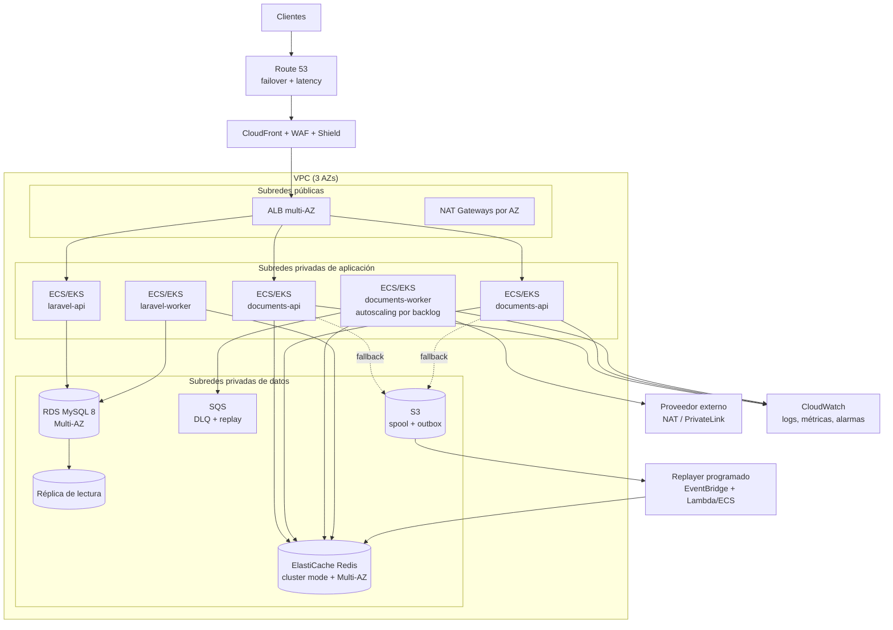

# Prueba Técnica Backend Senior — Estupendo

**Hugo Fabián Horta Flórez**  
Repositorio: https://github.com/favhyan1845/estupendo-senior-backend-challenge

Implementación de los tres requerimientos de la prueba y de las cuatro respuestas del cuestionario de defensa técnica.

## Contenido

1. [Cómo ejecutar](#1-cómo-ejecutar)
2. [Requerimiento 1 — Laravel: 100k facturas y 32 MB](#2-requerimiento-1--laravel-100k-facturas-y-32-mb)
3. [Requerimiento 2 — FastAPI asíncrono y resiliente](#3-requerimiento-2--fastapi-asíncrono-y-resiliente)
4. [Requerimiento 3 — Docker y arquitectura AWS](#4-requerimiento-3--docker-y-arquitectura-aws)
5. [Cuestionario de defensa técnica](#5-cuestionario-de-defensa-técnica)

---

## 1. Cómo ejecutar

### Docker (stack completo)

```bash
cp .env.example .env
docker compose up -d --build
```

| Servicio | Puerto host | Función |
|---|---|---|
| `laravel` | `8000` | Aplicación Laravel (`/up`) y comandos de facturas |
| `laravel-worker` | — | Worker de la cola `invoices` (`queue:work redis`) |
| `documents-api` | `8001` | API FastAPI (`/docs`, `/api/v1/documents/process`) |
| `documents-worker` | — | Consumidor de Redis Streams |
| `mock-external` | `9000` | Proveedor externo simulado (30% de fallos) |
| `mysql` | `3307` | MySQL 8 (`estupendo`, `estupendo_test`) |
| `redis` | `6379` | Cola, cache y contadores compartidos |

Al arrancar, Laravel espera a MySQL, ejecuta migraciones y siembra `SEED_INVOICES` (100.000 por defecto, idempotente).

```bash
# Procesar las 100.000 facturas con el límite duro de 32 MB
docker compose exec laravel php -d memory_limit=32M artisan invoices:process --json

# Enviar 1.000 documentos
curl -s -X POST http://localhost:8001/api/v1/documents/process \
  -H 'Content-Type: application/json' \
  -d '{"batch_id":"demo-1","documents":[{"document_id":"inv-1","document_type":"invoice","issuer_tax_id":"900123456-7","amount_cents":125000,"currency":"COP","issued_at":"2026-10-20T14:00:00Z"}]}'

# Estado de cola, DLQ, spool y circuit breaker
curl -s http://localhost:8001/api/v1/documents/stats | python3 -m json.tool

# Pruebas
docker compose run --rm -T laravel-test
docker compose run --rm -T documents-api pytest

# Detener
docker compose down
```

### Ejecución nativa (sin Docker)

```bash
# Laravel (PHP 8.2+, MySQL 8 / MariaDB 10.6+)
cd laravel
composer install
cp .env.example .env && php artisan key:generate
# Ajustar DB_* en .env y crear la base `estupendo`
php artisan migrate
php artisan invoices:seed --count=100000 --chunk=500
php -d memory_limit=32M artisan invoices:process --json
php artisan test

# FastAPI (Python 3.10+)
cd ../services/document-service
python -m venv .venv && source .venv/bin/activate
pip install -r requirements.txt
cp .env.example .env    # DOCS_REDIS_ENABLED=false usa cola en memoria + worker embebido
uvicorn app.workers.mock_external:app --port 9000 &
uvicorn app.main:app --port 8000
pytest
```

---

## 2. Requerimiento 1 — Laravel: 100k facturas y 32 MB

### Implementación

Comando principal: `php artisan invoices:process`.

1. **Lectura por keyset, sin OFFSET**: `WHERE status = 'pending' AND id > :lastId ORDER BY id LIMIT 501` sobre el índice `(status, id)`.
2. **PDO sin buffer**: conexión dedicada con `PDO::MYSQL_ATTR_USE_BUFFERED_QUERY => false`; las filas se entregan conforme llegan.
3. **Sin hidratación Eloquent**: cada fila se procesa como un array de 5 escalares.
4. **Cálculo de impuestos puro**: `CalculateInvoiceTax`, enteros en centavos y basis points, redondeo half-up.
5. **Actualización por lote**: un `UPDATE ... CASE id WHEN ...` por página, con `WHERE status = 'pending'` para idempotencia.
6. **Eventos de dominio**: `InvoiceBatchProcessed` por defecto (uno por lote) y `InvoiceProcessed` por factura con `--events=per_invoice`.
7. **Transacciones**: `chunked` por defecto (una transacción corta por lote) y `--transaction=single` para el modo literal del enunciado.
8. **Memoria**: `MemoryGuard` verifica el pico lógico en cada lote; el comando se ejecuta además con `php -d memory_limit=32M`.
9. **Escalado**: `--queue` encadena un `ProcessInvoiceBatchJob` por página, consumido por `laravel-worker`.
10. **Reanudación**: `--after-id` y el filtro por estado permiten reanudar sin reprocesar.

```bash
php artisan invoices:seed --count=100000 --chunk=500 --fresh
php -d memory_limit=32M artisan invoices:process --json
php -d memory_limit=32M artisan invoices:process --events=per_invoice --json
php -d memory_limit=32M artisan invoices:process --transaction=single --json
php artisan invoices:process --queue --limit=1000 --batch=100
```

### Evidencia

**100.000 facturas, `memory_limit=32M`:**

| Entorno | Transacción | Eventos | Tiempo | Pico PHP |
|---|---|---|---|---|
| Nativo (PHP 8.3 / MariaDB 10.6) | por lote | por lote | 10,40 s | **25,71 MB** |
| Nativo | por lote | por factura | 15,31 s | 25,71 MB |
| Nativo | única | por lote | 13,58 s | 25,72 MB |
| **Docker (PHP 8.3 / MySQL 8)** | por lote | por lote | 15,48 s | **6,13 MB** (8 MB allocator) |

- El pico es constante al pasar de 5.000 a 100.000 filas: la memoria es O(lote), no O(total).
- **Keyset vs OFFSET** (`ANALYZE FORMAT=JSON`): la misma página de 501 filas lee **501 filas** con keyset y **100.000** con `LIMIT 99500, 501`.
- **Locks** (`information_schema.innodb_trx`, a los 5 s): `--transaction=single` mantiene **50.373 filas bloqueadas**; el modo por lotes, **502** como máximo.

### Pruebas

`26 tests PHPUnit / 82 aserciones`, incluida una prueba en subproceso real con `php -d memory_limit=32M` que verifica `peak_memory_bytes < 32 MB`.

---

## 3. Requerimiento 2 — FastAPI asíncrono y resiliente

### Endpoint

`POST /api/v1/documents/process` (`async def`), máximo **1.000 documentos** por request.

```json
{
  "batch_id": "opcional",
  "documents": [
    {
      "document_id": "inv-1",
      "document_type": "invoice",
      "issuer_tax_id": "900123456-7",
      "amount_cents": 125000,
      "currency": "COP",
      "issued_at": "2026-10-20T14:00:00Z"
    }
  ]
}
```

Respuesta `202 Accepted`:

```json
{
  "batch_id": "demo-1",
  "accepted": 1000,
  "status": "accepted",
  "channel": "redis",
  "received_at": "2026-10-20T14:00:00.123456Z",
  "processing_time_ms": 8.17
}
```

### Implementación

1. **Recepción asíncrona**: el endpoint valida con pydantic y publica el lote con **un único `XADD`** a Redis Streams (timeout 150 ms), delegando el procesamiento a `documents-worker`.
2. **Respuesta < 200 ms**: no se llama al proveedor externo ni se espera al worker. Si Redis falla o excede el timeout, el lote se escribe en un **spool JSONL con `fsync`** y el endpoint responde igualmente `202`.
3. **Retry con Exponential Backoff**: 3 intentos, `0,1 s → 0,2 s` (cap 2 s), jitter ±20%; solo timeouts, errores de transporte, 429 y 5xx. Los 4xx son permanentes.
4. **Circuit Breaker**: 5 fallos consecutivos (validaciones agotadas) → **OPEN durante 30 s**; las llamadas fallan rápido y los documentos se desvían a la **DLQ**; después un único probe HALF_OPEN; éxito → CLOSED, fallo → OPEN otros 30 s.
5. **Dead Letter Queue**: `documents:dlq` en Redis con `reason`, `attempts`, `batch_id` y `failed_at`; si Redis falla, `dead-letter.jsonl` con `fsync`.
6. **Idempotencia**: `SET documents:seen:{document_id} NX EX 24h`; una entrega duplicada se ACKea sin volver a validar.
7. **Cola durable**: Redis con `appendonly yes` y `maxmemory-policy noeviction`; un replayer en background reenvía el spool cuando el broker vuelve.
8. **Observabilidad compartida**: `/api/v1/documents/stats` lee contadores y estado del breaker desde Redis, porque API y worker son procesos distintos.

### Evidencia (stack Docker)

- **1.000 documentos**: `202` en **8,17 ms** de servidor (43 ms round-trip), `972` validadas + `28` a DLQ = **1.000 procesadas**, `duplicate_documents=0`, lag de cola 0.
- **Circuito abierto** con `MOCK_FAILURE_RATE=1`: `state=open`, `retry_in_seconds=29,95`, 10/10 documentos a DLQ.
- **Redis caído**: 20 documentos → `202` con `channel=spool` en 20,13 ms; al volver Redis el replayer reenvió el lote y se procesaron 20/20 sin pérdida.
- **Cola Laravel**: 1.000 facturas despachadas con `--queue` → 10 jobs `ProcessInvoiceBatchJob`, 1.000/1.000 procesadas.

### Pruebas

`40 tests pytest`: breaker (apertura, ventana, HALF_OPEN, reapertura), retry/backoff, validador resiliente, DLQ, idempotencia, spool/replayer, cola (`lag`, un `XADD` por lote), endpoint y health.

---

## 4. Requerimiento 3 — Docker y arquitectura AWS

### docker-compose

`docker-compose.yml` levanta Laravel, FastAPI, MySQL y Redis, más los workers y el proveedor externo simulado:

- **Healthchecks** en MySQL (`mysqladmin ping`), Redis (`redis-cli ping`), Laravel (`/up`), API (`/health/live`) y mock; los servicios esperan dependencias con `condition: service_healthy`.
- **MySQL** inicializa `estupendo` y `estupendo_test` (`docker/mysql-init.sql`).
- **Redis** con `appendonly yes`, `maxmemory 256mb` y `maxmemory-policy noeviction` para no evacuar mensajes de la cola.
- **Volúmenes** para MySQL, Redis y el spool de documentos (`/data/spool`), que sobrevive a reinicios.
- **Laravel** ejecuta migraciones y seed al arrancar; `laravel-worker` consume la cola `invoices`.
- **FastAPI** corre con un worker de streams separado (`documents-worker`).
- Perfil `test` para `laravel-test` (`docker compose run --rm laravel-test`).

### Arquitectura AWS para alta disponibilidad



| Capa | Diseño HA | Fallo cubierto |
|---|---|---|
| Entrada | Route 53, CloudFront + WAF, ALB en ≥2 AZ | Caída de AZ, DDoS, TLS |
| Cómputo | ECS Fargate/EKS con ≥2 réplicas por servicio y rolling deployments | Caída de tarea/AZ, despliegues sin downtime |
| API vs. batch | Servicio Laravel separado del worker de facturas | Un batch pesado no afecta al tráfico HTTP |
| Cola | ElastiCache Redis cluster mode, Multi-AZ, failover automático y AOF | Pérdida de nodo/AZ (RPO ≈ 1 s) |
| Workers | Consumer group + autoscaling por longitud del stream/`XPENDING`; entradas pendientes reclamables con `XAUTOCLAIM` | Picos de tráfico y workers caídos |
| Base de datos | RDS MySQL Multi-AZ, backups + PITR, réplica de lectura y RDS Proxy | Fallo de instancia/AZ, agotamiento de conexiones |
| Contingencia | SQS DLQ con retención de 14 días; spool en S3 con versionado y lifecycle | Proveedor caído o broker saturado |
| Observabilidad | CloudWatch (logs/métricas/alarmas), X-Ray/OpenTelemetry | Detección y diagnóstico |
| Seguridad | Subredes privadas, security groups mínimos, Secrets Manager, KMS, roles IAM por tarea, TLS | Exposición de datos/credenciales |

**Flujo tolerante a fallos en AWS**

1. El ALB entrega el lote a `documents-api`.
2. El API escribe en Redis; si falla, escribe el lote en **S3** (particionado por instancia) y responde igualmente `202`. En Fargate el disco es efímero, por eso el spool local del compose se sustituye por S3/EFS.
3. Un replayer programado (EventBridge + ECS/Lambda) drena S3 hacia Redis cuando el broker se recupera, con idempotencia por `document_id`.
4. Los workers validan con reintentos y breaker; los fallos se depositan en **SQS DLQ** con retención extendida.
5. Alarmas: breaker abierto, profundidad de cola/DLQ, backlog del spool, p99 del endpoint y edad del mensaje más antiguo.
6. Runbook de replay: pausar consumidores → inspeccionar DLQ → corregir causa → reinyectar con rate limit → verificar idempotencia.

**DR multi-región:** Aurora Global Database (o réplica RDS cross-region), ElastiCache Global Datastore, S3 Cross-Region Replication y Route 53 failover; RTO < 15 min y RPO < 5 min, con restores de prueba periódicos.

**Nota:** Redis Streams sirve como buffer de baja latencia; para retención de días y replay nativo, SQS/Kinesis es preferible. El código ya usa el contrato `DocumentQueue`, por lo que añadir `SqsDocumentQueue` no requiere rediseño.

---

## 5. Cuestionario de defensa técnica

### 1. Laravel & PDO: ¿por qué `Invoice::all()->each(...)` o `chunk()` agotan la memoria o ralentizan MySQL, y cómo lo solucioné?

**Problema:** El procesamiento masivo de facturas (100.000 registros) consumía cientos de MB de memoria y se degradaba progresivamente: a medida que avanzaba, cada lote tardaba más. En producción esto significa riesgo de timeouts, caídas del servicio y bloqueos de la base de datos.

**Causa:** El código cargaba todas las facturas en memoria de una vez, y la paginación usada para mitigarlo obligaba a MySQL a descartar miles de filas en cada lectura (coste creciente con el volumen).

**Solución:** Refactoricé el proceso para leer en streaming (memoria constante, sin cargar todo), usar paginación eficiente (el mismo lote tarda lo mismo sea el número 1 o el número 200) y actualizar en bloque en vez de fila por fila (100.000 queries → ~200).

**Resultado medido:**

1. 100.000 facturas en 10,4 segundos (15,5 s en Docker)
2. Pico de memoria: 6-25 MB, plano sin importar el volumen → escala lineal a 1M de facturas
3. Verificado con perfiles de MySQL, no estimaciones.

**Técnico**

**`Invoice::all()->each(...)`** ejecuta un `SELECT *` sin límite y construye la colección completa **antes** de iterar: 100.000 modelos Eloquent vivos a la vez (atributos, `$original`, `$changes`, casts, eventos), cientos de MB. Además, PDO usa consultas *buffered* por defecto, por lo que el result set completo también se materializa en el cliente.

**`chunk()`** acota los modelos por iteración, pero:

1. **Usa `OFFSET`**: la página 200 ejecuta `LIMIT 99500, 500`; MySQL debe leer y descartar 99.500 filas para devolver 500. El coste por página crece y el total es cuadrático. Medido con `ANALYZE FORMAT=JSON`: keyset lee **501 filas**, `OFFSET 99500` lee **100.000** para la misma página.
2. **Hidrata modelos y dispara eventos por fila** (`retrieved`, `saving`, `saved`), y si se hace `save()` por fila son 100.000 UPDATE. `chunkById()` corrige el OFFSET, pero sigue hidratando modelos y escribiendo fila a fila.

**Solución:**

- `StreamingPdo` con `PDO::MYSQL_ATTR_USE_BUFFERED_QUERY => false`, `ATTR_EMULATE_PREPARES => false` y `LIMIT 501`.
- Keyset pagination (`status = 'pending' AND id > :lastId ORDER BY id`) sobre el índice `(status, id)`.
- Filas como arrays de 5 escalares, sin modelos Eloquent.
- Impuestos con enteros (`CalculateInvoiceTax`) y **un `UPDATE ... CASE` por página**.
- Evento por lote (`InvoiceBatchProcessed`) o por factura con payloads escalares.
- `MemoryGuard` + `php -d memory_limit=32M` + `gc_collect_cycles()`.

**Resultado:** 100.000 facturas en 10,40 s nativo / 15,48 s en Docker, pico **25,71 MB** nativo y **6,13 MB** en Docker, plano respecto al volumen total.

### 2. Python & Event Loop: ¿qué ocurre si ejecuto cálculos pesados o una librería síncrona dentro de un `async def` y cómo lo evito?

**Problema:** En un sistema asíncrono, un solo cálculo pesado o una llamada bloqueante puede congelar el servicio completo: todas las peticiones se quedan en cola a la vez, la latencia se dispara, fallan los health checks y Kubernetes puede reiniciar los pods.

**Riesgo típico:** Usar una librería síncrona (muy común: clientes HTTP o de base de datos síncronos) dentro de código asíncrono. El bug no se ve en pruebas con poco tráfico; aparece en producción bajo carga.

Cómo lo mitigamos (por diseño, no por remedio posterior):

**El endpoint público hace lo mínimo:** valida y encola. El trabajo pesado vive en workers separados, con concurrencia acotada — un pico de validaciones no afecta a la API.
Todos los clientes externos (proveedor, Redis) son asíncronos.
Operaciones bloqueantes se ejecutan fuera del hilo principal.
Timeouts, reintentos limitados y corte automático si el proveedor falla (circuit breaker), para que una dependencia caída no arrastre al servicio.
**Impacto:** Previsibilidad bajo carga y aislamiento de fallos — el endpoint responde rápido aunque los workers estén saturados o el proveedor externo esté lento.

**Técnico**

El event loop de asyncio corre en **un solo hilo**. Una corrutina solo cede el control en un `await` que realmente suspenda. Si dentro de un `async def` se ejecuta una librería bloqueante (`requests`, `time.sleep`, un driver de DB síncrono, `boto3`) o cálculo pesado en Python puro, el hilo queda ocupado y **ninguna otra corrutina avanza**: se serializan las requests, suben las latencias, fallan los health checks y se acumulan timeouts. El GIL hace que usar threads no ayude en cargas CPU-bound.

**Cómo lo evito:**

1. **Camino de la request mínimo:** el endpoint solo valida con pydantic y publica el lote (1 `XADD`); no llama al proveedor externo ni hace trabajo pesado.
2. **I/O asíncrono:** `httpx.AsyncClient` con pool para el proveedor y `redis.asyncio` para el broker; nunca clientes síncronos en el loop.
3. **Bloqueos fuera del loop:** el `fsync` del spool se ejecuta con `anyio.to_thread.run_sync`. Para cálculo CPU-bound usaría un `ProcessPoolExecutor` o lo movería a un worker/cola.
4. **Trabajo de fondo separado:** la validación corre en `documents-worker`, con `asyncio.Semaphore` para acotar concurrencia; un pico de validaciones no afecta al endpoint.
5. **Timeouts y backpressure:** 150 ms de publicación, 2 s de timeout del proveedor, reintentos acotados y circuit breaker.

### 3. Resiliencia en producción: si Redis se llena o se cae durante un pico, ¿cómo evito perder lo que los clientes están enviando?

**Problema:** En picos de tráfico, un componente intermedio (Redis) puede llenarse o caerse. El riesgo silencioso es perder mensajes de clientes sin que nadie lo note: el sistema responde "recibido" pero el mensaje se evapora.

**Decisión de diseño clave:** Nunca respondemos "aceptado" si el dato aún no está a salvo en disco. Si Redis falla o está lleno, la escritura falla de forma visible y activamos una contingencia, en vez de dejar que el sistema descarte mensajes silenciosamente.

**Contingencia:** Los datos se escriben en un archivo local persistente y se reintroducen automáticamente en la cola cuando Redis se recupera. Si fallara también el disco, devolvemos un error claro al cliente para que reintente, en lugar de una confirmación falsa.

**Garantías que esto aporta:**

Cero pérdida de mensajes, verificado con pruebas de caos: llenar Redis, provocar failovers, llenar el disco — y comprobar que todo lo aceptado termina validado o en cola de reintentos.
Sin duplicados aunque haya reintentos, mediante idempotencia.

**Visibilidad:** alertas de backlog y presión sobre el sistema, con mecanismos de control de carga si el volumen crece.

**Evidencia real:** Con Redis detenido, se aceptaron 20 documentos (~20 ms por petición); al reiniciar Redis, el sistema los reenvió automáticamente y se procesaron 20/20 sin pérdida.

**En AWS:** el buffer durable pasaría a SQS/Kinesis (con 14 días de retención) y el spool a S3, dejando Redis solo como acelerador, nunca como almacenamiento de registro.

**Tëcnico**

**Configuración:** Redis corre con `maxmemory-policy noeviction` y AOF. Con `allkeys-lru`, un pico podría **evacuar mensajes de la cola silenciosamente**; prefiero que la escritura falle y activar la contingencia.

**Principio:** nunca responder `202` si el lote no es durable. El API intenta publicar en Redis con timeout de 150 ms; si Redis está caído, lleno o lento:

1. escribe el lote en un **spool JSONL con `fsync`**;
2. responde `202` con `channel: "spool"`;
3. un **replayer** en background reenvía el lote a Redis cuando el broker se recupera.

El spool está en un volumen y sobrevive a reinicios; el drenaje rota el archivo y conserva las entradas no reenviadas incluso si el proceso se cancela. Si el disco también falla, se devuelve `503` con `Retry-After` en lugar de un `202` falso.

Además:

- **Idempotencia** por `document_id` (`SET NX` + TTL), para que un reenvío no duplique la validación.
- **DLQ** para los documentos que no se pudieron validar; nunca se descartan.
- **Alertas** de backlog del spool, profundidad de cola/DLQ y memoria de Redis; backpressure (429/503) y cuotas por tenant si el backlog crece.
- En AWS: **SQS/Kinesis** como buffer durable (retención 14 días) y **S3** como spool (Fargate tiene disco efímero), con replayer programado y particiones por instancia. Redis queda como acelerador, no como sistema de registro.
- Pruebas de caos: llenar Redis, provocar failover y llenar el disco del spool, verificando que aceptados = validados + DLQ + pendientes.

**Evidencia en Docker:** con Redis detenido, 20 documentos → `202`, `channel=spool`, 20,13 ms; al reiniciar Redis el replayer reenvió el lote y se procesaron **20/20 sin pérdida**.

### 4. Criterio de arquitectura (análisis crítico): ¿es viable procesar 100k registros en una única `DB::transaction` y disparar un evento Eloquent por registro?

no es viable en producción de alto volumen. Lo implementé como modo opcional para medirlo con datos reales, pero el diseño por defecto es por lotes.

Por qué falla, en términos de impacto:

**Bloquea a los demás:** durante toda la ejecución (decenas de segundos), miles de filas quedan bloqueadas para cualquier otro proceso. Medido: 50.000+ filas bloqueadas con transacción única vs. ~500 con lotes. Cualquier operación concurrente del negocio se queda esperando o falla.

**Sin punto de control:** si algo falla en la fila 99.999 — un registro inválido, un timeout, un reinicio del worker — se pierde todo el trabajo y hay que empezar de cero. Con lotes, el fallo afecta solo a 500 filas y se reanuda desde el último punto.

**Sobrecarga de la base de datos:** una transacción gigante genera problemas de replicación, recuperación lenta tras un crash y presión de memoria en MySQL.

No es operable: no se puede pausar, reanudar ni paralelizar.

**Es más lento además:** medido, 15,3 s vs. 10,4 s (~47% más), así que ni siquiera gana en velocidad.

**El diseño que sí uso:** transacciones cortas por lote de 500 filas, reanudable desde checkpoints, idempotente (segura ante reintentos), y eventos por lote. Como siguiente paso, el patrón Outbox para garantizar que ningún evento se pierda ni se dispare de forma fantasma.

**Cuándo sí sería aceptable:** lotes pequeños, en ventana de mantenimiento y sin escritores concurrentes. Para 100k facturas en producción.

**Técnico**

**No es viable en producción de alto volumen.** Lo implementé como modo opcional (`--transaction=single`, `--events=per_invoice`) para medirlo, pero el valor por defecto es `chunked` + evento por lote.

**Riesgos técnicos:**

1. **Locks durante toda la corrida:** locks de fila y next-key locks sobre el índice secundario. Medido a los 5 s de una corrida de 100k: **50.373 filas bloqueadas** con transacción única frente a **502** como máximo en modo por lotes. Cualquier escritor concurrente espera, con riesgo de `Lock wait timeout` y deadlocks.
2. **Undo log, binlog y replicación:** una transacción de 100k escrituras genera undo masivo, un evento de binlog enorme, retraso en réplicas y recuperación lenta ante crash o rollback.
3. **Blast radius:** un registro inválido, un deadlock o un timeout revierte **las 100k filas**. No hay progreso parcial ni checkpoint; el reintento empieza de cero. Con lotes, el fallo se limita a 500 filas.
4. **Conexión y timeout:** la transacción ocupa una conexión y un snapshot durante toda la corrida; un `max_execution_time`, failover o reinicio del worker aborta todo.
5. **Eventos:** con `ShouldDispatchAfterCommit` habría que **retener 100.000 eventos** hasta el commit (memoria proporcional al total); dentro de la transacción, los consumidores pueden leer datos no confirmados. Además, el modo `per_invoice` tardó **15,31 s frente a 10,40 s** (≈47% más).
6. **Operabilidad:** no se puede pausar, reanudar, escalar ni paralelizar.

**Cómo lo reestructuré:**

- Transacciones cortas por página de 500 filas.
- Keyset + `UPDATE ... CASE` por lote (200 transacciones cortas frente a 100k `save()`).
- Idempotencia por estado (`WHERE status='pending'`) y checkpoint (`--after-id`, jobs encadenados).
- Evento de dominio por lote; `per_invoice` solo si el negocio lo exige.
- **Outbox pattern** como siguiente paso: evento en la misma transacción de la página y relay asíncrono, garantizando *at-least-once* sin eventos fantasma.

**Cuándo sí sería aceptable:** lotes pequeños (unidades de miles), ventana de mantenimiento sin escritores concurrentes y sin eventos por fila. Para 100k facturas en producción.


